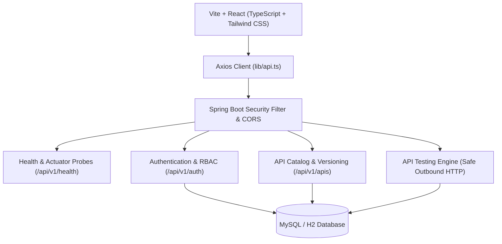

# API Hub – A Centralized API Lifecycle Management Platform

API Hub is an enterprise-grade full-stack platform for managing the complete lifecycle of APIs. Teams can create, catalog, document, test, version, govern, and monitor APIs across their entire organization from a single consolidated interface.

---

## Architecture Overview



---

## Core Modules & Scope

1. **User Management**: 5 user roles (`ADMIN`, `DEVELOPER`, `QA_ENGINEER`, `PROJECT_MANAGER`, `CONSUMER`) with JWT authentication.
2. **API Catalog**: Projects, registration, search, multi-field filtering, and pagination.
3. **API Version Management**: Immutable version snapshots, diff comparison, and deprecation.
4. **Documentation**: Structured endpoint parameters, schema definitions, and OpenAPI 3.x compliance.
5. **API Testing**: Automated test suites, assertion evaluations, response captures, and strict SSRF defenses.
6. **Access Control**: Centralized RBAC enforcement at both backend service and frontend navigation levels.
7. **Audit Trail**: Append-only audit logs recording every lifecycle transition and sensitive update.
8. **Dependency Mapping**: Directional upstream/downstream relationship visualization and downstream impact analysis.
9. **Release Management**: 4-stage delivery pipeline (`Development` &rarr; `Testing` &rarr; `Staging` &rarr; `Production`) with approval policies.
10. **Portfolio Dashboard**: Real-time aggregated metrics computed from persisted operational data.

---

## Repository Structure

```
├── backend/                  # Spring Boot 4.x / Java 25 backend
│   ├── src/main/java/        # Layered architecture (common, config, security, features)
│   ├── src/main/resources/   # Application YAML profiles (dev, test)
│   ├── pom.xml               # Maven configuration
│   └── mvnw.cmd              # Maven wrapper
├── frontend/                 # Vite + React (TypeScript) frontend
│   ├── src/                  # App shell, components, features, lib, styles
│   ├── package.json          # Frontend dependencies & scripts
│   └── vite.config.ts        # Vite & Tailwind configuration
├── docs/                     # Comprehensive architecture and branch documentation
│   ├── branches/             # Per-feature branch contribution READMEs
│   └── development-tracker.md# Lifecycle status & verification tracker
└── .github/                  # CI workflows and PR templates
```

---

## Local Development Setup

### Prerequisites
- **Java**: 21+ (Detected Java 25)
- **Node.js**: 18+ & npm
- **MySQL**: 8.0+ running on port `3306`

### 1. Backend Setup
```bash
cd backend
# Run backend with active dev profile
./mvnw spring-boot:run
```
Backend API will be accessible at: `http://localhost:8080/api/v1`
Health check: `http://localhost:8080/api/v1/health`

### 2. Frontend Setup
```bash
cd frontend
npm install
npm run dev
```
Frontend will be available at: `http://localhost:3000` (or `http://localhost:5173`)

---

## Branch Contribution Documentation

| Branch | Contribution Guide |
|:---|:---|
| `feature/project-foundation` | [Foundation README](docs/branches/feature-project-foundation/README.md) |
| `feature/user-management` | *Upcoming Phase 2* |
| `feature/api-catalog` | *Upcoming Phase 2* |
