# API Hub – A Centralized API Lifecycle Management Platform

API Hub is an enterprise-grade full-stack platform for managing the complete lifecycle of APIs. Teams can create, catalog, document, test, version, govern, and monitor APIs across their entire organization from a single consolidated interface.

---

## Architecture Overview

```mermaid
flowchart TD
    Client["Vite + React (TypeScript + Tailwind CSS)"]
    APIClient["Axios Client (lib/api.ts)"]
    SpringGateway["Spring Boot Security Filter & CORS"]
    HealthController["Health & Probes (/api/v1/health)"]
    AuthController["Authentication & RBAC (/api/v1/auth)"]
    CatalogController["API Catalog & Projects (/api/v1/apis)"]
    DocController["OpenAPI Docs & Endpoints (/api/v1/endpoints)"]
    VersionController["Versioning Engine (/api/v1/versions)"]
    TestingEngine["API Testing Engine (Safe Outbound HTTP)"]
    DependencyEngine["Dependency Graph & Impact Analysis"]
    ReleaseEngine["4-Stage Release Pipeline"]
    DashboardEngine["Real-time Portfolio Analytics"]
    ImpExpEngine["OpenAPI 3.x Import & Export"]
    EnvEngine["Environment & Secret Management"]
    NotifEngine["In-App Alert & Notification Center"]
    Database[("MySQL / H2 Database")]

    Client --> APIClient
    APIClient --> SpringGateway
    SpringGateway --> HealthController
    SpringGateway --> AuthController
    SpringGateway --> CatalogController
    SpringGateway --> DocController
    SpringGateway --> VersionController
    SpringGateway --> TestingEngine
    SpringGateway --> DependencyEngine
    SpringGateway --> ReleaseEngine
    SpringGateway --> DashboardEngine
    SpringGateway --> ImpExpEngine
    SpringGateway --> EnvEngine
    SpringGateway --> NotifEngine

    AuthController --> Database
    CatalogController --> Database
    DocController --> Database
    VersionController --> Database
    TestingEngine --> Database
    DependencyEngine --> Database
    ReleaseEngine --> Database
    DashboardEngine --> Database
    ImpExpEngine --> Database
    EnvEngine --> Database
    NotifEngine --> Database
```



---

## Complete Module Inventory (All 15 Modules Delivered)

| # | Branch | Key Scope & Capabilities |
|:---:|:---|:---|
| 1 | `feature/project-foundation` | Monorepo layout, Spring Boot starter integration, Vite React frontend, CORS/Health, Docs |
| 2 | `feature/user-management` | User entity, 5 roles, secure login, JWT authentication, user registration |
| 3 | `feature/api-catalog` | Projects, API catalog, multi-field filtering, pagination, search |
| 4 | `feature/api-documentation` | Version-scoped endpoint documentation, OpenAPI 3.x generation |
| 5 | `feature/api-version-management` | Semantic versioning, immutable snapshots, diff comparison, deprecation |
| 6 | `feature/api-testing` | Test suites, test cases, safe outbound HTTP execution, SSRF defense |
| 7 | `feature/access-control` | Centralized RBAC permissions, method security, UI RoleGuards |
| 8 | `feature/audit-trail` | Append-only audit logs, lifecycle events, sensitive payload masking |
| 9 | `feature/dependency-mapping` | Upstream/downstream relations, cycle detection, impact analysis |
| 10 | `feature/release-management` | 4-stage pipeline (`Dev → Testing → Staging → Production`), approvals |
| 11 | `feature/dashboard` | Aggregated real-time metrics, lifecycle distribution, pass rate |
| 12 | `feature/api-import-export` | OpenAPI JSON/YAML import parser and export generator |
| 13 | `feature/environment-management` | Environments, base URLs, variable masking & unmasking |
| 14 | `feature/notifications` | In-app notification inbox, event alerts, broadcast messaging |
| 15 | `feature/integration-hardening` | E2E integration smoke tests, CI automation, unified workspace navigation |

---

## Complete API Endpoint Catalog

```
Authentication & Users
  POST   /api/v1/auth/login                  - Authenticate user & issue JWT
  POST   /api/v1/users                       - Register new user
  GET    /api/v1/users                       - List users

API Catalog & Projects
  GET    /api/v1/projects                    - List projects
  POST   /api/v1/projects                    - Create project
  GET    /api/v1/apis                        - Search & paginate APIs
  POST   /api/v1/apis                        - Register API interface
  GET    /api/v1/apis/{id}                   - Get API details

Documentation & Versions
  GET    /api/v1/versions/{id}/endpoints     - List endpoints for version
  POST   /api/v1/endpoints                   - Document endpoint
  GET    /api/v1/versions/{id}/openapi       - Generate live OpenAPI 3.0 spec
  GET    /api/v1/apis/{apiId}/versions       - List API versions
  POST   /api/v1/apis/{apiId}/versions       - Create semantic version
  GET    /api/v1/versions/compare            - Compare two versions

Automated Testing & SSRF Protection
  GET    /api/v1/apis/{apiId}/test-suites    - List test suites
  POST   /api/v1/apis/{apiId}/test-suites    - Create test suite
  POST   /api/v1/test-suites/{id}/run        - Execute test suite safely

Governance, Audit & Dependencies
  GET    /api/v1/audit-logs                  - Query append-only audit trail
  GET    /api/v1/apis/{apiId}/dependencies   - Upstream & downstream graph
  GET    /api/v1/apis/{apiId}/dependencies/impact - Downstream impact analysis
  POST   /api/v1/dependencies                - Add dependency (cycle-guarded)

Releases & Analytics
  GET    /api/v1/apis/{apiId}/releases       - List releases for API
  POST   /api/v1/releases                    - Create release in DEVELOPMENT
  POST   /api/v1/releases/{id}/promote       - Promote stage with approvals
  GET    /api/v1/dashboard/summary           - Real-time aggregated metrics

Interop, Environments & Alerts
  POST   /api/v1/apis/import                 - Ingest OpenAPI 3.x spec
  GET    /api/v1/versions/{id}/export        - Download OpenAPI 3.x spec file
  GET    /api/v1/environments               - List deployment environments
  POST   /api/v1/environments/{id}/variables - Set masked secret variable
  GET    /api/v1/notifications              - List user notifications
  POST   /api/v1/notifications               - Dispatch notification
  PATCH  /api/v1/notifications/{id}/read     - Mark notification read
```

---

## Local Development Setup

### Prerequisites
- **Java**: 21+ (Java 25 compatible)
- **Node.js**: 18+ & npm
- **MySQL**: 8.0+ running on port `3306` (or H2 in-memory test profile)

### 1. Backend Setup
```bash
cd backend
./mvnw clean spring-boot:run
```
Default bootstrap admin:
- **Email**: `admin@apihub.local`
- **Password**: `Admin@123456`

### 2. Frontend Setup
```bash
cd frontend
npm install
npm run dev
```
Open `http://localhost:3000` to interact with the full platform workspace.
